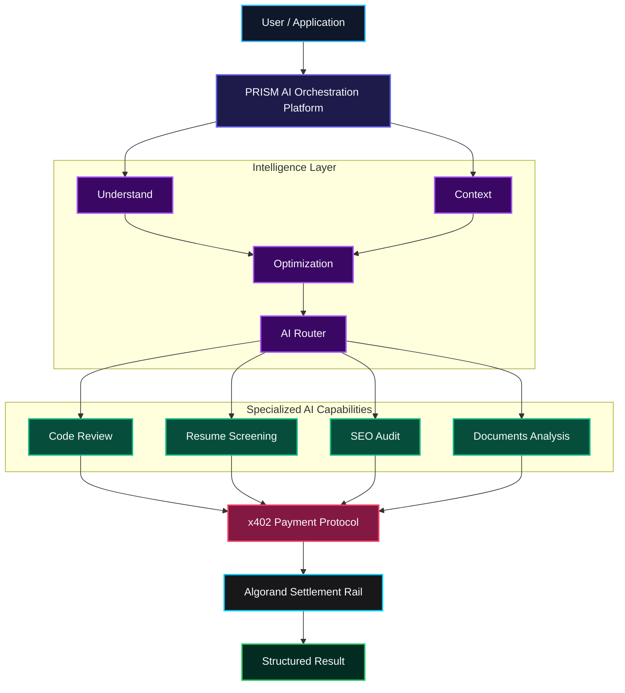
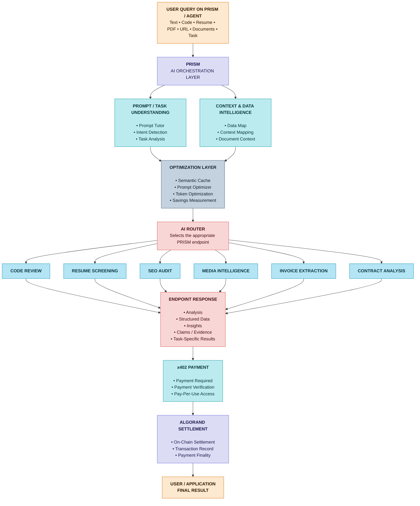
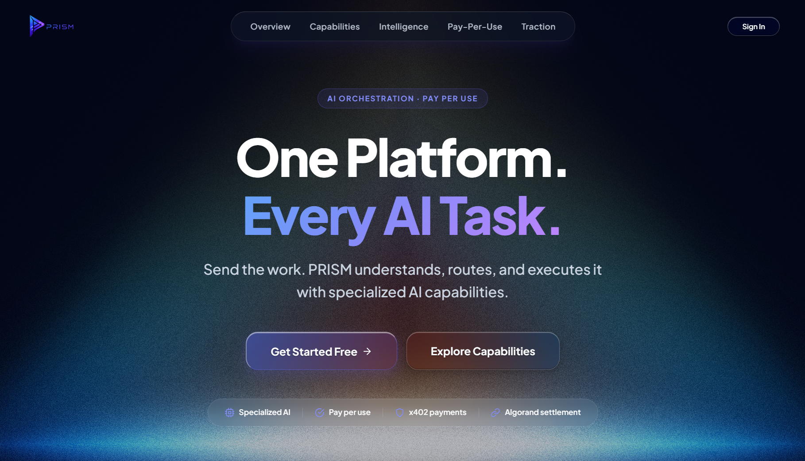
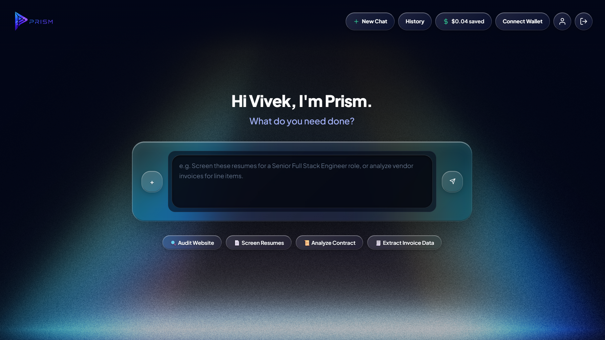
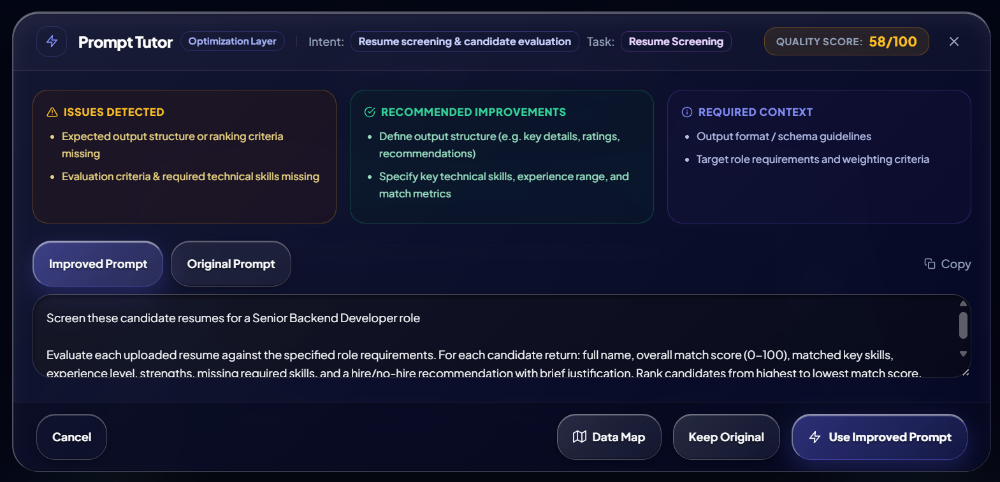
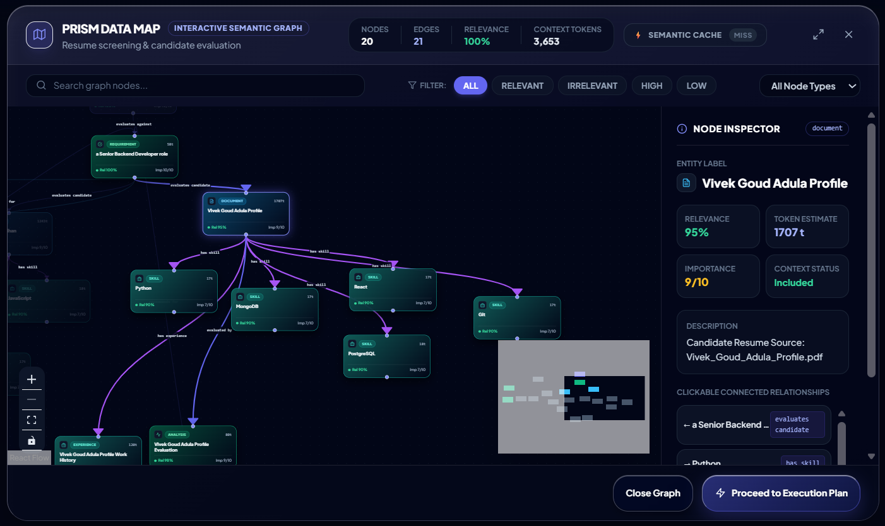
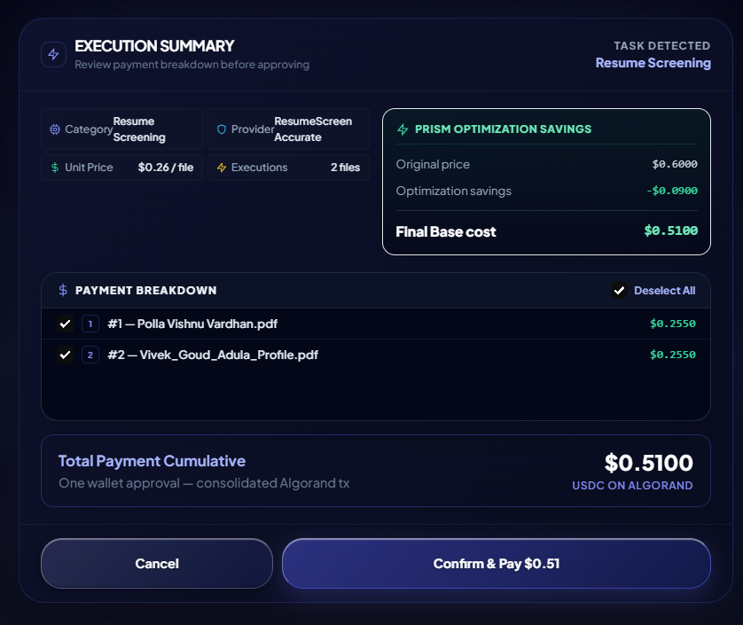
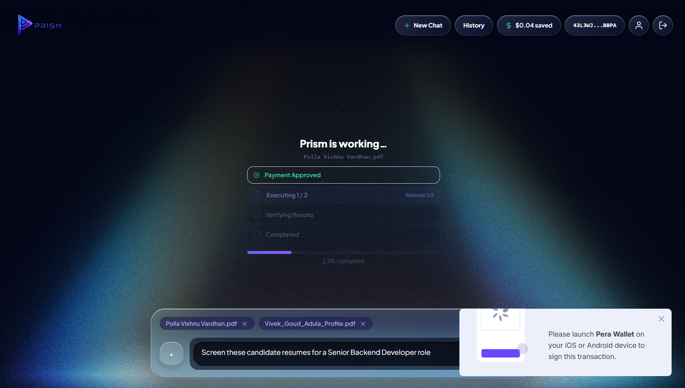
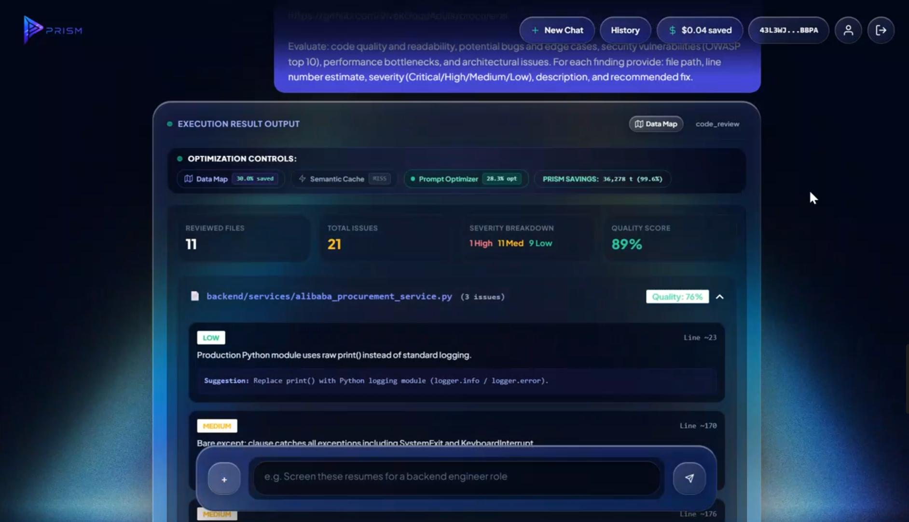
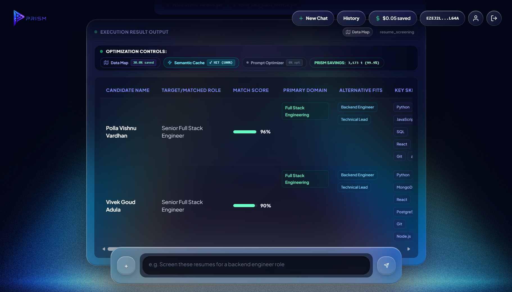

# PRISM — AI Orchestration Platform

<p align="center">

**One Platform. Every AI Task.**

Understand → Optimize → Route → Execute

[](https://algorand.co/)
[](https://dev.algorand.co/resources/x402-on-algorand/)
[](https://www.typescriptlang.org/)
[](https://react.dev/)
[](https://www.mongodb.com/)

</p>

<p align="center">
  <b>AI orchestration with pay-per-use execution.</b><br/>
  PRISM understands the task, optimizes the context, routes it to the right AI capability, executes it, and handles payment through x402 with settlement on Algorand.
</p>

---

## What is PRISM?

AI applications today often depend on multiple specialized AI services.

One task may require:

* a code analysis service
* a document extraction model
* a resume screening system
* an SEO analyzer
* a research or verification service
* different AI models for different quality requirements

The problem is not a lack of AI capabilities.

The problem is **connecting the right capability to the right task, at the right cost, with a simple execution and payment layer.**

**PRISM is an AI orchestration platform built to solve that problem.**

Instead of making users discover, configure, and manage individual AI services, PRISM provides a single interface that:

```text
Understand
    ↓
Optimize
    ↓
Route
    ↓
Execute
    ↓
Settle
    ↓
Return Result
```

PRISM exposes specialized AI capabilities as **pay-per-use services protected by x402**, with payment settlement on **Algorand**.

---

## Problem

AI services are increasingly specialized, but using them together remains fragmented.

A typical workflow looks like:

```text
Find an AI service
        ↓
Understand its API
        ↓
Check pricing
        ↓
Prepare the input
        ↓
Choose a model
        ↓
Manage credentials
        ↓
Make the request
        ↓
Handle payment
        ↓
Process the result
```

This becomes difficult when applications need multiple capabilities.

### The core problems

* **Fragmented AI services** — different APIs for different tasks.
* **Model selection complexity** — choosing the appropriate quality/cost tier.
* **Repeated context preparation** — the same task context often needs to be structured repeatedly.
* **Disconnected workflows** — AI capabilities operate independently instead of composing naturally.
* **Payment friction** — pay-per-use AI services need a standardized payment mechanism.
* **Cost inefficiency** — unnecessary tokens and repeated work increase execution costs.

PRISM brings these concerns into one orchestration layer.

---

## Solution

PRISM provides a single AI execution layer between the application and specialized AI capabilities.



The application does not need to manage every specialized capability independently.

PRISM handles the orchestration.

---

## Core Features

| Feature | Description |
| --- | --- |
| **Task Understanding** | Identifies what the user is actually trying to accomplish. |
| **Prompt Tutor** | Evaluates task prompts and identifies missing context or structure. |
| **Data Map** | Structures task inputs and context for downstream execution. |
| **Semantic Cache** | Reuses compatible prior results where applicable. |
| **Prompt Optimizer** | Converts raw instructions into optimized execution context. |
| **AI Router** | Selects the appropriate capability and model tier. |
| **Code Review** | Analyze repositories and source code for quality and issues. |
| **Resume Screening** | Evaluate candidate resumes against role requirements. |
| **SEO Auditing** | Analyze webpages for SEO-related issues. |
| **Invoice Extraction** | Extract structured information from invoices. |
| **Contract Analysis** | Analyze contracts and extract relevant information. |
| **Media Intelligence** | Extract, verify, compare, and research information from sources. |
| **x402 Payments** | Pay-per-use access to protected AI capabilities. |
| **Algorand Settlement** | Payments settle through Algorand. |

---

## Intelligence Layer

PRISM is more than a collection of AI endpoints.

An orchestration layer sits between the user's request and the final capability.

### Prompt Tutor

Evaluates the quality and completeness of an incoming task.

It can identify:

* unclear instructions
* missing context
* missing output structure
* insufficient task specification

and suggest improvements before execution.

### Data Map

Transforms incoming task information into structured context that can be used by downstream capabilities.

This allows PRISM to reason about:

* task inputs
* entities
* relationships
* requirements
* execution context

### Semantic Cache

Checks whether compatible prior work can be reused before executing another expensive AI operation.

### Prompt Optimizer

Optimizes the task context before model execution.

### AI Router

Selects the appropriate execution path based on the task and configured capability/model tiers.

```text
Raw Task
   │
   ▼
Prompt Tutor
   │
   ▼
Data Map
   │
   ▼
Prompt Optimizer
   │
   ▼
Semantic Cache
   │
   ▼
AI Router
   │
   ▼
Specialized Capability
```

---

## System Architecture



PRISM uses x402 as the payment/access mechanism around its paid capabilities.

On Algorand, x402 follows the model where a client requests a resource, the server can return `402 Payment Required`, and a facilitator verifies and settles the payment before the protected resource is returned.

---

## x402 Payment Flow

Every paid PRISM capability is designed around a clear unit of execution.

Examples include:

* one code-review operation
* one resume-screening operation
* one invoice extraction
* one contract analysis
* one claim verification
* one source comparison
* one research operation

The conceptual flow is:

```text
Application
     │
     │ Request AI capability
     ▼
PRISM Endpoint
     │
     │ 402 Payment Required
     ▼
Payment Requirements
     │
     │ USDC
     ▼
GoPlausible Facilitator
     │
     ▼
Algorand
     │
     │ Payment verified / settled
     ▼
PRISM Execution
     │
     ▼
AI Capability
     │
     ▼
Structured Result
```

PRISM uses the x402 implementation for its protected endpoints, with the GoPlausible facilitator handling payment verification and settlement.

The Global x402 Challenge specifically requires participating projects to deploy paid x402 endpoints on Algorand Mainnet and use the GoPlausible facilitator.

---

## Why Algorand?

PRISM uses Algorand as the settlement layer for its x402 payment flow.

This gives the payment layer:

* on-chain settlement
* verifiable transactions
* predictable transaction costs
* fast finality
* USDC-based payment support

The important separation is:

```text
PRISM
  │
  │ Orchestration
  ▼
AI Capabilities
  │
  │ Payment Access
  ▼
x402
  │
  │ Verification / Settlement
  ▼
Algorand
```

PRISM focuses on the **orchestration and AI execution layer**, while Algorand provides the underlying settlement rail.

---

## AI Capabilities

### Engineering

#### Code Review

Analyze source repositories and identify:

* code quality issues
* security concerns
* architectural problems
* maintainability issues
* prioritized findings

---

### Human Resources

#### Resume Screening

Evaluate resumes against role requirements and return structured candidate analysis.

---

### Marketing

#### SEO Auditing

Analyze webpages and identify SEO-related issues and recommendations.

---

### Finance

#### Invoice Extraction

Extract structured information from invoices.

---

### Legal

#### Contract Analysis

Analyze contracts and extract relevant information.

---

### Media Intelligence

PRISM includes multiple media-oriented capabilities:

```text
Claim Extraction
       ↓
Claim Verification
       ↓
Source Comparison
       ↓
News Research
```

These capabilities can be used independently or as part of larger workflows.

---

## How PRISM Works

### 1. Submit a Task

The user provides a natural-language request.

Example:

```text
Review this GitHub repository for security and
code quality issues.
```

### 2. Understand

PRISM analyzes the task and determines what needs to be executed.

### 3. Optimize

The Intelligence Layer structures the task, maps its context, and optimizes execution.

### 4. Route

The AI Router determines the appropriate capability and execution tier.

### 5. Pay

The protected capability is accessed through x402.

### 6. Execute

The specialized AI capability processes the request.

### 7. Settle

The payment is verified and settled through the configured Algorand payment flow.

### 8. Return

PRISM returns a structured result to the user/application.

---

## Product Screens

> Screenshots below should be added from the actual PRISM application. Do not use mock or stock images.

### Landing Page

The PRISM entry point explains the orchestration model and available capabilities.



### PRISM Console

The main task execution interface.



### Prompt Tutor

Shows how PRISM evaluates and improves an incoming task.



### Data Map

Shows the structured context generated by PRISM.



### Execution Summary

Shows capability selection, workload information, optimization and execution details.



### x402 Payment

Shows the payment and settlement stage.



### Code Review

Shows the final structured code-review result.



### Resume Screening

Shows structured candidate screening.



---

## Execution Model

PRISM follows a pay-per-use model.

There are no mandatory seat-based subscriptions for individual capability execution.

The basic model is:

```text
Task
  ↓
Capability
  ↓
Execution
  ↓
x402 Payment
  ↓
Result
```

Pricing is capability-specific and defined by the backend endpoint configuration.

See:

[`docs/api-catalogue.md`](docs/api-catalogue.md)

for the current endpoint catalogue and pricing.

---

## Technology Stack

| Layer | Technology |
| --- | --- |
| Frontend | React + TypeScript + Vite |
| Styling | Tailwind CSS |
| Backend | Node.js + TypeScript |
| API Framework | Hono |
| AI | Groq / configured LLM providers |
| Database | MongoDB |
| Payments | x402 |
| Facilitator | GoPlausible |
| Settlement | Algorand |
| Discovery | x402 Bazaar integration |
| Deployment | Vercel + Render |

The exact endpoint/model configuration is maintained in the backend source and documentation.

---

## Project Structure

```text
PRISM/
│
├── README.md
├── ARCHITECTURE.md
├── X402_IMPLEMENTATION_GUIDE.md
├── render.yaml
├── vercel.json
│
├── docs/
│   ├── api-catalogue.md
│   ├── development.md
│   ├── intelligence-layer.md
│   ├── x402-protocol.md
│   └── assets/
│       ├── architecture/
│       └── screenshots/
│
├── X402-Usecase/
│   └── projects/
│       └── X402-Usecase/
│           ├── src/
│           ├── public/
│           ├── tests/
│           └── package.json
│
└── x402-demo-server/
    ├── handlers/
    ├── middleware/
    ├── models/
    ├── routes/
    ├── services/
    ├── scripts/
    ├── tests/
    ├── public/
    ├── endpoints.config.ts
    ├── endpoints.registry.ts
    ├── pricing.config.ts
    └── index.ts
```

---

## Getting Started

### Prerequisites

* Node.js
* npm
* MongoDB
* Groq API key
* Algorand-compatible payment configuration
* GoPlausible facilitator configuration

Check the project configuration and `.env.example` for the exact environment variables required.

---

### 1. Clone

```bash
git clone https://github.com/VivekGoudAdula/PRISM.git
cd PRISM
```

---

### 2. Configure Backend

```bash
cd x402-demo-server
npm install
```

Create your environment file:

```bash
cp .env.example .env
```

Configure the required variables.

Never commit:

```text
.env
.env.mainnet
.env.testnet
.env.*.local
```

---

### 3. Start Backend

```bash
npm run dev
```

---

### 4. Start Frontend

Open another terminal:

```bash
cd X402-Usecase/projects/X402-Usecase
npm install
npm run dev
```

Open the local URL shown by Vite.

For the complete setup and troubleshooting guide:

[`docs/development.md`](docs/development.md)

---

## Testing

Backend validation and tests are located under:

```text
x402-demo-server/tests/
```

Run:

```bash
cd x402-demo-server
npm test
```

or:

```bash
npm run test:all
```

Build the backend:

```bash
npm run build
```

Build the frontend:

```bash
cd X402-Usecase/projects/X402-Usecase
npm run build
```

---

## Documentation

| Document | Purpose |
| --- | --- |
| [`ARCHITECTURE.md`](ARCHITECTURE.md) | Complete system architecture |
| [`docs/x402-protocol.md`](docs/x402-protocol.md) | PRISM's x402 implementation |
| [`docs/api-catalogue.md`](docs/api-catalogue.md) | Endpoint catalogue and pricing |
| [`docs/intelligence-layer.md`](docs/intelligence-layer.md) | Intelligence Layer internals |
| [`docs/development.md`](docs/development.md) | Local setup and development |
| [`X402_IMPLEMENTATION_GUIDE.md`](X402_IMPLEMENTATION_GUIDE.md) | x402 implementation reference |

---

## Built for the Global x402 Challenge

PRISM was built for the **Global x402 Challenge by Algorand**, with a focus on turning specialized AI capabilities into composable, pay-per-use services.

The challenge centers on paid x402 endpoints running on Algorand Mainnet, real usage, and settlement through the GoPlausible facilitator.

PRISM explores that model from the **orchestration layer**:

```text
Specialized AI Capabilities
          ↓
      PRISM
          ↓
       x402
          ↓
     GoPlausible
          ↓
       Algorand
```

The result is an AI execution platform where capabilities can be accessed through a standardized pay-per-use mechanism.

---

## Roadmap

### Current

* AI task orchestration
* Specialized AI capabilities
* Prompt intelligence
* Context mapping
* Semantic caching
* Prompt optimization
* AI routing
* x402-protected execution
* Algorand settlement
* Pay-per-use capabilities

### Next

* More specialized AI endpoints
* More composable workflows
* Broader external integrations
* Expanded developer access
* Additional AI capability providers

### Longer Term

PRISM can evolve toward a broader marketplace of composable AI capabilities where applications can discover and consume specialized AI services programmatically.

Future capabilities are subject to implementation and should not be interpreted as currently available functionality.

---

## Security

Never commit:

* API keys
* private keys
* wallet secrets
* database credentials
* JWT secrets
* production environment files

Use `.env.example` as the configuration template.

For security issues, please report them privately rather than publishing credentials or exploit details.

---

## License

See [`LICENSE`](LICENSE).

---

## Built with

**AI orchestration · x402 · Algorand · TypeScript · React · MongoDB**

<p align="center">

**PRISM**

*One Platform. Every AI Task.*

</p>
